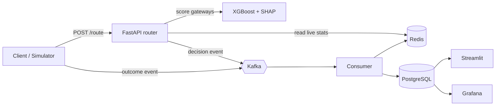

# AI-Powered Intelligent Payment Routing Engine

Routes each payment to the gateway most likely to succeed at the lowest cost and latency, explains every decision with SHAP, and reroutes automatically when a gateway fails.

> **Note:** all data is simulated. The simulator in `simulator/` generates gateways, transactions, outages and outcomes.

## Architecture



Full design, scoring definition, event contracts and decisions: [docs/architecture.md](docs/architecture.md).

## Repository layout

```
payment-router/
  docker-compose.yml   # Stage 1
  simulator/           # Stage 2: gateways, transactions, outages
  data/                # generated datasets (git-ignored)
  sql/                 # Stage 3: schema and analysis queries
  ml/                  # Stages 4-6: features, baselines, XGBoost, SHAP
  api/                 # Stage 7: FastAPI service
  pipeline/            # Stages 8-9: Kafka, Redis updater, circuit breaker
  dashboards/          # Stage 10: Streamlit pages, theme, Grafana
  tests/               # Stage 11
  docs/
```

## Progress

- [x] **Stage 0:** scope, architecture, repo skeleton, design system
- [x] Stage 1: environment and docker-compose
- [x] Stage 2: data simulator
- [x] Stage 3: PostgreSQL schema
- [x] Stage 4: EDA and feature engineering
- [x] Stage 5: baselines and XGBoost model
- [x] Stage 6: per-decision explanations (exact TreeSHAP via XGBoost; global SHAP plots still to do)
- [x] Stage 7: FastAPI service (`/route`, `/outcome`, `/gateways`, `/health`)
- [x] Stage 8: Kafka event pipeline and Redis health store
- [x] Stage 9: circuit breaker, probing, failover retries
- [ ] Stage 10: dashboards
- [ ] Stage 11: tests, load test, CI, documentation

MVP path: Stages 1, 2, 3, 5, 7.

## Getting started (Stage 1)

Requirements: Docker Desktop (install from docker.com and open it once so the engine is running) and Python 3.11 or newer. Postgres is exposed on host port **5433** to avoid clashing with a local Postgres on 5432. Run every command from the project root (the folder containing `docker-compose.yml`).

```bash
# 1. Config
cp .env.example .env            # Windows PowerShell: Copy-Item .env.example .env

# 2. Python environment
python -m venv .venv
source .venv/bin/activate       # Windows PowerShell: .venv\Scripts\Activate.ps1
pip install -r requirements.txt

# 3. Start Postgres, Redis, Kafka, Grafana
docker compose up -d
docker compose ps               # wait until postgres, redis and kafka show "healthy"

# 4. Check connectivity from Python
python scripts/check_services.py
```

Grafana is at http://localhost:3000 (user and password from `.env`). Stop everything with `docker compose down`, or `docker compose down -v` to also wipe the data volumes.

## Simulator (Stage 2)

Generates 300k historical payment attempts across 5 fake gateways, with hidden patterns the model must discover:

| Gateway | Trade-off | Hidden pattern |
|---|---|---|
| gw_d DeltaPG | most reliable, fastest, most expensive (2.4%) | weak on SBI |
| gw_a AlphaPay | solid, mid cost (2.0%) | weak on high-value cards (≥ ₹20k) |
| gw_b BetaPay | cheap (1.6%), good on UPI | degrades in the 19:00 to 22:59 peak |
| gw_c CoreGate | mid cost (1.8% + ₹2), best on netbanking | weak on UPI and on travel merchants |
| gw_e EchoPay | cheapest (1.2%), slowest, no netbanking | least reliable overall |

Four incidents (two hard outages, two degradations) are placed so that two fall in the last 20% of the period, which is held out for testing failover.

```bash
python -m simulator.generate --n 300000 --days 60 --seed 42 --out data
pytest                      # simulator checks: determinism, schema, outages, hidden patterns
```

Outputs go to `data/` (git-ignored): `transactions.csv`, `gateways.csv`, `outages.csv`.

Design notes:
- Historical transactions are routed to a **uniformly random** supported gateway (an exploration phase), so every gateway's behaviour is observed without selection bias.
- `outages.csv` is ground truth for evaluation and must never be used as a model feature.
- `simulator.model.success_probability` gives the true outcome probability for any (transaction, gateway) pair, which Stage 5 uses to evaluate routing policies by replay.

## Database (Stage 3)

```bash
python scripts/load_data.py --reset     # create schema, load data/*.csv, backfill metrics
pytest tests/test_db_load.py            # integration checks against the loaded database
```

The loader runs in one transaction, so a failure leaves the database unchanged. Without `--reset` it is idempotent: re-running adds nothing twice.

| Table | Purpose |
|---|---|
| `payment_methods`, `banks`, `merchant_categories` | lookup tables, enforced by foreign keys |
| `gateways`, `gateway_methods` | gateway fees and which payment methods each supports |
| `transactions` | the payment request, which is what the router sees |
| `payment_attempts` | one row per attempt; a retry or failover is another attempt for the same `txn_id` |
| `routing_decisions` | chosen gateway, per-gateway scores and SHAP explanation as `jsonb` |
| `gateway_metrics` | 15-minute buckets: attempts, successes, avg and p95 latency, fees |
| `sim_outages` | simulator ground truth, for evaluation only |
| `v_attempt_facts` (view) | denormalized attempts joined to transactions, used for analysis and features |

Integrity is enforced in the schema: `CHECK (success = (failure_code IS NULL))`, foreign keys on every reference, and indexes on time and `(gateway_id, time)`. Connect with any SQL client on `localhost:5433` (credentials in `.env`).

## EDA and features (Stage 4)

```bash
python scripts/load_data.py                              # re-run once to create the new analysis view
python -m ml.eda                                         # tables, weak segments, 4 charts -> reports/eda/
python -m ml.build_dataset                               # feature table -> data/features.pkl
docker compose exec -T postgres psql -U router -d payment_router < sql/analysis_queries.sql
pytest tests/test_features.py
```

**What the analysis finds**, using only the loaded data (steady state, incident windows excluded):

| Gateway | Weakest segment found | Success there vs its average |
|---|---|---|
| gw_a | large amounts (25k-50k bucket) | 89.0% vs 95.1% |
| gw_b | evening hours 19 to 21 | about 82 to 83% vs 91.3% |
| gw_c | UPI, and travel merchants | 87.9% and 85.5% vs 90.9% |
| gw_d | SBI | 89.4% vs 95.7% |
| gw_e | cards and evening hours | 87.4% and about 86% vs 89.1% |

During the four incidents success collapses to between 4% and 33% (normally 89% to 96%).

**Features** (`ml/features.py`): 22 per attempt. Transaction and time features (amount, amount bucket, method, bank, merchant category, hour, weekday) plus rolling stats of the same gateway over 5, 15 and 60 minutes (attempt count, success rate, gateway-side failure rate, mean latency) and a 15-minute p95 latency.

**Leakage rule:** a rolling feature at time `t` uses only earlier attempts of the same gateway whose outcome was already known at `t` (an attempt's outcome is known at `ts + latency`). Nothing counts toward its own features. The tests enforce this three ways: a hand-computed example, a brute-force recomputation on sampled rows, and a "no peeking" test showing that deleting all later data leaves earlier features unchanged. Deliberately breaking the code makes these tests fail.

**Split:** chronological 60 / 20 / 20 (train Jan 1 to Feb 6, valid to Feb 18, test to Mar 1). The test period contains gw_d's outage and gw_b's degradation, which the model never sees in training.

The feature set does not encode the simulator's hidden patterns (no "is peak hour" or "is high-value card" flags), so any pattern the model learns, it found from the raw columns.

## Model and evaluation (Stage 5)

```bash
python -m ml.train        # XGBoost on the chronological training split -> ml/artifacts/model.joblib
python -m ml.evaluate     # replay every routing policy on the held-out test period
```

Add `--source csv` to read `data/*.csv` instead of PostgreSQL. If XGBoost will not import on macOS, run `brew install libomp`.

**Model.** XGBoost predicts P(success | transaction, gateway, recent gateway health) from the 22 leakage-safe features of Stage 4. The validation split drives early stopping; the test split is used only for the final report. `ml.train` prints AUC, log-loss, Brier score and expected calibration error against a "gateway prior" baseline, plus a calibration table.

**Policies compared** on the same test transactions: random (the logged behaviour), cheapest, best overall gateway, best gateway per payment method (all three rule-based policies use training data only), the ML router (highest predicted success), the cost-aware ML router, and an oracle that knows the true probabilities (an upper bound, not achievable).

**Cost-aware score.** `score = P(success) - lambda_cost * normalised_fee - lambda_latency * normalised_latency`, with fee and latency min-max scaled across the candidate gateways of each transaction. The weights are tuned on the validation period from model predictions only: among weight pairs whose predicted success is within 0.1 percentage points of the success-only router, pick the one with the lowest combined fee-and-latency index.

**Counterfactual replay.** Logs show only the gateway that was used. The simulator knows the true success probability of every gateway, so any policy is scored on its expected outcome. Assumption: gateway health depends on time and incidents, not on our own traffic.

**IPS cross-check.** The same policies are re-estimated from logged outcomes alone, using self-normalised inverse propensity weighting (valid because the log routed uniformly at random). It should agree with the replay within its stated interval; it is the method that would still work on real logs.

Outputs: `reports/results.json` and `reports/policy_comparison.png`.

## Live routing API (Stages 6-7)

```bash
uvicorn api.main:app --port 8000          # Postgres if reachable, else data/*.csv
open http://localhost:8000/docs           # interactive docs: try POST /route
python scripts/demo_live.py               # in a second terminal: watch it react to an incident
```

```bash
curl -s localhost:8000/route -H 'content-type: application/json' \
  -d '{"amount_inr": 2500, "method": "card", "bank": "HDFC", "merchant_category": "retail"}'
```

| Endpoint | Purpose |
|---|---|
| `POST /route` | Scores every enabled gateway that supports the payment method and returns the winner, ranked alternatives, a one-line summary and the top three SHAP drivers |
| `POST /outcome` | Reports the result of an attempt so the rolling gateway health stays current |
| `GET /gateways` | Last-15-minute volume, success rate and latency per gateway, plus enabled state |
| `POST /gateways/{id}/disable` and `/enable` | Manual kill switch |
| `GET /health` | Service status and model version |

Decision flow: build the same 22 features used in training (the rolling gateway stats come from the live outcome record), predict P(success) per gateway with XGBoost, apply the tuned cost and latency weights, pick the highest score. Drivers are exact TreeSHAP values from XGBoost (`pred_contribs`), in log-odds.

Current limits, by design for now: gateway health is held in memory (Redis comes with the Kafka pipeline in Stage 8), and automatic circuit breaking and failover arrive in Stage 9. On startup the bundled history is shifted to the present as a demo seed.

### Circuit breaker and failover (Stage 9)

Each gateway has a breaker (`api/breaker.py`):

| State | Meaning |
|---|---|
| closed | Normal. Gateway-side failures (timeouts, gateway errors) in the last 120 s are counted. 20 or more attempts with at least half failing trips it. Bank declines never count. |
| open | No traffic for the cooldown (30 s by default). |
| half open | About 10% of low-value transactions (INR 2,000 or less) are sent as probes. Five successes in a row close the breaker. One failure reopens it. |

When a breaker closes, the router forgets that incident's failures, so a verified recovery gets traffic back immediately instead of waiting up to an hour for the rolling windows to clear. If every gateway for a payment method is tripped, the router still uses the best one (`mode: fail_open`) rather than rejecting the payment.

Failover for clients: if a gateway call fails, send the same request to `POST /route` again with `"exclude": ["gw_d"]` to get the next best gateway.

Settings are environment variables, for example `BREAKER_COOLDOWN_S=15` or `BREAKER_PROBE_SHARE=0.2`. Run the whole story with `bash scripts/run_demo.sh`.

### Event pipeline (Stage 8)

```
 outcome stream ──► Kafka payment.outcomes ──► API consumer ──► Redis health + circuit breakers
 POST /route ─────► Kafka payment.decisions ──► decision sink ──► PostgreSQL routing_decisions
```

- **Redis** holds the last 75 minutes of gateway outcomes (one sorted set per gateway) and the manual kill switch, so health survives an API restart and other processes can read it. Without Redis the API falls back to memory.
- **Kafka** carries two topics. `payment.outcomes` brings attempt results from other services into the router. `payment.decisions` records every routing decision with its scores and explanation. Without Kafka the API runs normally and keeps messages in a local buffer.
- **Decision sink** (`python -m pipeline.decision_sink`) stores each decision in `routing_decisions`, creating the matching `transactions` row. Replays are safe because duplicates are ignored.
- **Stream replay** (`python -m pipeline.stream --incident gw_d`) publishes recorded outcomes around a real incident, so you can watch the breaker react.

Run the whole thing: `docker compose up -d`, then `python scripts/pipeline_demo.py`.

Environment: `ROUTER_HEALTH=auto|redis|memory`, `EVENT_BUS=auto|kafka|none`, `REDIS_PREFIX`, `KAFKA_BOOTSTRAP_SERVERS`.

## Results

All numbers are on the held-out last 20% of a 300,000-transaction simulated dataset (60 days, seed 42, 60,000 test transactions, two incidents in the test period). Policies are scored by counterfactual replay against the simulator's true probabilities; the IPS column re-estimates the same quantity from logged outcomes only.

**Model quality (test split).** XGBoost AUC 0.703 vs 0.562 for a per-gateway prior; log-loss 0.2543 vs 0.2808; expected calibration error 0.0064.

| Policy | Success rate | IPS check | Success during incidents | Effective fee | Avg latency |
|---|---|---|---|---|---|
| Random (logged behaviour) | 91.71% | 91.84% | 75.5% | 1.843% | 623 ms |
| Cheapest gateway | 88.74% | 89.35% ±0.56 | 84.0% | 1.258% | 881 ms |
| Best overall gateway | 93.03% | 93.36% ±0.44 | 43.3% | 2.400% | 435 ms |
| Best gateway per method | 93.52% | 93.76% ±0.43 | 51.1% | 2.320% | 458 ms |
| **ML router (XGBoost)** | **96.97%** | 97.05% ±0.30 | **95.6%** | 2.275% | 354 ms |
| ML cost-aware | 96.82% | 96.92% ±0.31 | 95.6% | 2.258% | 360 ms |
| Oracle (upper bound) | 97.11% | 97.24% ±0.29 | 96.2% | 2.262% | 355 ms |

- The ML router lifts success by **+3.5 points over the best rule-based policy** (+3.9 over best overall, +8.2 over cheapest) and sits 0.14 points below the oracle.
- During gateway incidents the rule-based policies keep sending traffic to a degraded gateway; the ML router holds **95.6% vs 43-51%**, because the rolling gateway-health features reveal the incident within minutes.
- The cost-aware variant gives up 0.15 points of success to cut fees 2.7% to 5.9% against the better rule-based policies and to reduce latency. Cost savings are modest by design: the success gain is worth more than the fee gap between gateways.
- Caveat: results come from a simulator whose hidden patterns I wrote, so they show the pipeline recovers and exploits structure that exists, not what a production uplift would be. The evaluation method (leakage-safe features, chronological split, IPS cross-check) is the part that transfers to real logs.
- Calibration is good except the lowest-probability decile, where the model slightly over-predicts (0.796 predicted vs 0.769 observed).


## UI design system

Jet black, cerulean and neon rose. Fonts: Space Grotesk (headings), Inter (body), JetBrains Mono (numbers). Tokens live in `dashboards/theme.py` and `.streamlit/config.toml`.
