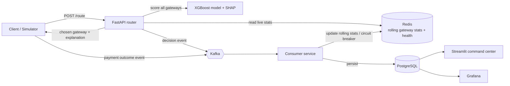

# Architecture

## 1. Problem

Given an incoming payment, choose the payment gateway most likely to process it successfully, at the lowest cost and latency, using only information available at decision time. If the chosen gateway fails, retry through the next-best one. Every decision must be explainable and auditable.

> All transaction and gateway data in this project is **simulated**. The simulator is part of the project and is documented in `simulator/`.

## 2. Data flow



Request path (synchronous, latency-critical): `Client -> API -> Redis + model -> response`.
Learning/observability path (asynchronous): `API / outcomes -> Kafka -> consumer -> Redis + Postgres -> dashboards`.

## 3. Components

| Component | Responsibility | Stage |
|---|---|---|
| `simulator/` | Gateway definitions, transaction generator, outage windows, outcome generator | 2 |
| `sql/` | Schema, indexes, analysis queries | 3 |
| `ml/` | Feature engineering, baseline router, XGBoost training, evaluation, SHAP | 4-6 |
| `api/` | FastAPI service: `/route`, `/health`, `/metrics` | 7 |
| `pipeline/` | Kafka producers and consumer, Redis updater, circuit breaker | 8-9 |
| `dashboards/` | Streamlit pages, theme, Grafana provisioning | 10 |
| `tests/` | pytest unit and API tests, load test scripts | 11 |

## 4. Definition of "best gateway"

Routing is a constrained choice, not a single prediction.

1. **Hard filter:** exclude gateways that Redis marks `unhealthy` (circuit breaker open) or that do not support the payment method.
2. **Score** each remaining gateway `g` for transaction `t`:

```
score(g, t) = P(success | g, t)
              - λ_cost    * norm_cost(g, t)
              - λ_latency * norm_latency(g, t)
```

   - `P(success | g, t)` comes from the XGBoost classifier.
   - `norm_cost` = fee for this transaction divided by transaction amount, min-max scaled across gateways.
   - `norm_latency` = expected latency (recent p50 from Redis), min-max scaled across gateways.
   - Starting weights: `λ_cost = 0.15`, `λ_latency = 0.10`. Success probability dominates by design. Tune on the validation period.
3. **Choose** `argmax score`. Keep the ranked list so failover can use the next entry.

## 5. Baselines and success metrics

Baselines (Stage 5):
- **B1: cheapest gateway** for the payment method.
- **B2: highest historical success rate** overall.

Headline metrics, all measured on a **time-based held-out period** via routing replay against the simulator:
- Overall success rate uplift vs. B1 and B2 (percentage points)
- Cost saved vs. B2 (percent of processed volume)
- Mean and p95 latency of the chosen gateway
- Success rate during an outage window (failover on vs. off)

Service-level targets (Stage 11): `/route` p95 latency measured under load, reported as measured, not assumed.

## 6. Event contracts (draft)

`routing-decisions` (key: `txn_id`)
```json
{"txn_id": "...", "ts": "...", "amount": 0, "method": "upi", "bank": "...",
 "chosen_gateway": "gw_b", "scores": {"gw_a": 0.0}, "top_factors": [["recent_success_rate", 0.0]]}
```

`payment-outcomes` (key: `txn_id`)
```json
{"txn_id": "...", "gateway": "gw_b", "success": true, "latency_ms": 0, "failure_code": null, "attempt": 1}
```

Rules:
- `txn_id` is the idempotency key. A retry through another gateway reuses the same `txn_id` with an incremented `attempt`, and the consumer must not double-count a transaction.
- Consumers must tolerate duplicate and out-of-order events.

## 7. Key design decisions

| Decision | Choice | Reason |
|---|---|---|
| Model | XGBoost classifier per (txn, gateway) pair | Strong on tabular data, fast inference, works with TreeSHAP |
| Alternative noted | Multi-armed / contextual bandit | Handles explore/exploit directly. Mention as future work |
| Train/test split | Time-based | Avoids leakage, mirrors production |
| Live stats store | Redis | Sub-millisecond reads on the request path |
| System of record | PostgreSQL | Auditable history, SQL analysis, dashboards |
| Event bus | Kafka (KRaft, single broker) | Decouples serving from learning/observability |
| Leakage rule | Rolling features use only data strictly before the transaction timestamp | Prevents inflated offline metrics |

## 8. Non-goals

- No real payment processing or real gateway integrations.
- No PCI scope: no card numbers, only simulated categorical attributes.
- No online model retraining in the first version. Retraining is an offline job.
- No multi-region or high-availability deployment.

## 9. Risks

| Risk | Mitigation |
|---|---|
| Model only rediscovers patterns hard-coded in the simulator | Judge by methodology: baselines, time split, leakage control, uplift. Say so openly in the README |
| Scope creep across Kafka, Redis, Grafana, SHAP | Build the MVP first: Stages 1, 2, 3, 5, 7 |
| Unmeasured performance claims | Load test before quoting any latency figure |
